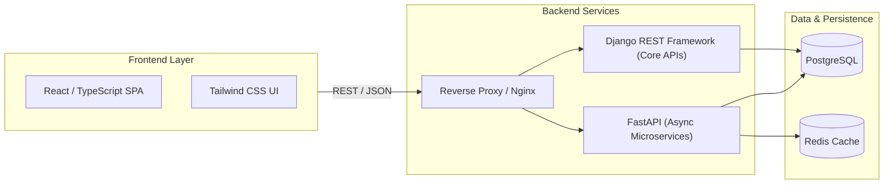

<div align="center">

# 🚀 Python Full-Stack Journey

**An intensive, production-oriented curriculum and reference repository mastering modern full-stack engineering with Python, asynchronous backends, relational databases, React frontend architectures, and cloud DevOps.**

[](https://python.org)
[](https://fastapi.tiangolo.com)
[](https://djangoproject.com)
[](https://flask.palletsprojects.com)
[](https://www.postgresql.org/)
[](https://react.dev)
[](https://docker.com)

[Curriculum Overview](#-curriculum-overview) • [Full-Stack Architecture](#-full-stack-architecture) • [Module Roadmap](#-module-roadmap) • [Getting Started](#-getting-started) • [Contributing](#-guidelines)

</div>

---

## 🎯 Purpose & Vision

This repository serves as an end-to-end knowledge base and code companion for building production-grade software. Rather than isolated tutorial exercises, it emphasizes:
- **Clean Architecture & SOLID Principles**: Maintainable, decoupled layer design.
- **Type Safety & Validation**: Utilizing Python typing, Pydantic, and TypeScript.
- **Asynchronous I/O Performance**: Concurrency, event loops, and non-blocking database queries with AsyncPG and FastAPI.
- **Enterprise Patterns**: JWT authentication, role-based access control (RBAC), caching strategies with Redis, and containerized deployment with Docker.

---

## 🏗️ Full-Stack Architecture



---

## 📚 Curriculum Overview

| Module | Track | Focus & Core Competencies | Status |
| :--- | :--- | :--- | :---: |
| **`01-python/`** | Core Engineering | OOP, Iterators/Generators, Decorators, Context Managers, Asyncio | ✅ Active |
| **`02-sql/`** | Persistence & Data | Relational Modeling, Indexing, Joins, Transactions, ORM vs Raw SQL | ✅ Active |
| **`03-django/`** | Enterprise Monoliths | MVT Pattern, Django ORM, Signals, Middlewares, Template Engine | 🔄 In Progress |
| **`04-django-rest/`** | API Engineering | Serializers, ViewSets, JWT Authentication, Pagination, Permissions | 🔄 In Progress |
| **`05-flask/`** | Lightweight Services | Blueprints, Flask-SQLAlchemy, Factory Pattern, Microservices | 🔄 In Progress |
| **`06-fastapi/`** | High-Throughput APIs | Pydantic v2 Models, Async Endpoints, OpenAPI/Swagger Docs, Dependency Injection | 🔄 In Progress |
| **`07-react/`** | Modern Frontend | React 18, Custom Hooks, State Management, Axios Integration, Tailwind | 🔄 In Progress |
| **`08-devops/`** | Infrastructure | Dockerizing Fullstack Apps, Docker Compose, GitHub Actions CI/CD | 🔄 In Progress |
| **`09-projects/`** | Capstone Applications | Production-ready full-stack applications with auth, payment, and background workers | 🎯 Planned |

---

## 📂 Detailed Module Breakdown

### `01-python/` — Python Mastery
- **Day 01**: Primitives, Type Hinting, Operators, Dynamic Typing, I/O Operations.
- **Day 02**: Control Flow, List/Dict/Set Comprehensions, Pattern Matching (Python 3.10+).
- **Day 03**: Functions, `*args`/`**kwargs`, Lambda, Closures, Scopes & Namespaces.
- **Day 04+**: Object-Oriented Architecture (Dunder Methods, Inheritance, Abstract Base Classes), Generators, Decorators, and Async/Await fundamentals.

### `02-sql/` — Relational Databases
- Schema normalization (1NF, 2NF, 3NF, BCNF).
- Complex query construction: subqueries, CTEs (Common Table Expressions), Window Functions (`ROW_NUMBER`, `RANK`).
- Indexing strategies (B-Tree, GIN, Hash) and query optimization with `EXPLAIN ANALYZE`.

### `06-fastapi/` — Modern Asynchronous APIs
- Asynchronous routing and request lifecycle.
- Schema validation with Pydantic v2 models.
- OAuth2 with Password Flow & JWT Bearer token security.
- Background tasks and real-time WebSockets.

---

## 🚀 Getting Started

### 1. Clone the Repository
```bash
git clone https://github.com/deekshi07/python-fullstack-journey.git
cd python-fullstack-journey
```

### 2. Set Up Python Environment
```bash
python -m venv venv

# Windows
.\venv\Scripts\activate

# macOS / Linux
source venv/bin/activate
```

### 3. Run Practice Modules
```bash
# Example: Run Day 1 practice
python 01-python/day01/practice.py
```

---

## 💡 Code Quality & Conventions

All modules follow **PEP 8** style guidelines:
- Formatting: `black` and `isort`
- Linting & Type Checking: `flake8` and `mypy --strict`
- Automated Testing: `pytest` and `pytest-asyncio`

---

## 👤 Author

**Deekshith S J**
- GitHub: [@deekshi07](https://github.com/deekshi07)
- LinkedIn: [Deekshith S J](https://www.linkedin.com/in/deekshith-s-j-807241279/)
- Email: sjdeekshith2002@gmail.com
